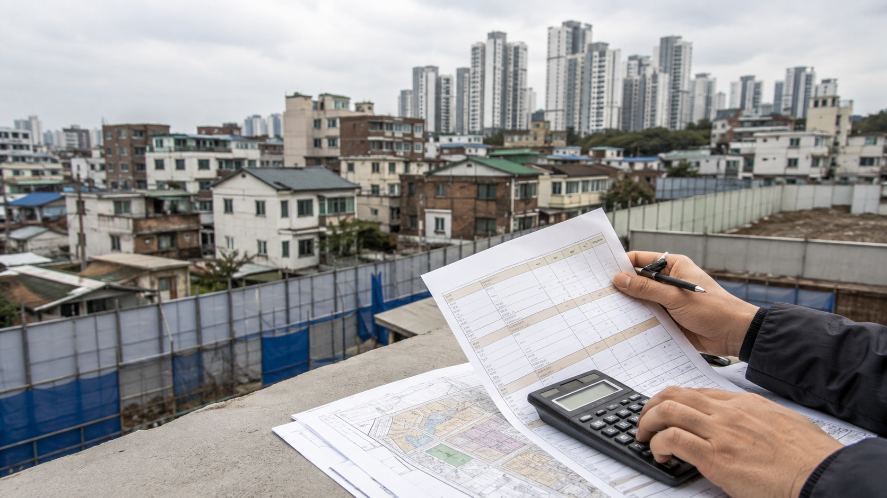

그림에서 봐야 할 핵심은 매매가격 하나가 아니라 조합원 지위, 앞으로 낼 분담금, 이주비 대출이 서로 다른 항목이라는 점이다.

재개발 입주권을 매수하려는 사람은 계약금보다 **매수인이 실제로 조합원으로 인정되는지**를 먼저 확인해야 한다. 2026년 11월 3일 기준 도시정비법 제39조는 투기과열지구 재개발에서 관리처분계획 인가 후 건축물이나 토지를 양수한 사람의 조합원 자격을 제한할 수 있다고 정한다. 예외가 있는지는 양도인의 사정과 사업 단계별 요건을 따로 확인해야 하므로, 중개대상물 설명만 믿고 계약금을 보내면 안 된다. [국가법령정보센터 제39조](https://www.law.go.kr/lsLinkCommonInfo.do?chrClsCd=010202&lsJoLnkSeq=1029442565)

## 계약 전에 받아야 할 서류

| 확인 대상 | 받아서 대조할 자료 | 현금계획에 반영할 것 |
|---|---|---|
| 권리와 단계 | 등기사항전부증명서, 관리처분계획인가 고시, 조합원 분양계약서 | 조합원 지위 승계 불가 시 계약 중단 또는 해제 조건 |
| 분담금 | 조합의 분담금 통지서, 기납부 영수증, 납부 일정 | 이미 낸 돈과 앞으로 낼 돈을 분리 |
| 이주비 | 대출 약정서, 잔액·이자·채무인수 가능 여부 | 승계 실패 시 잔금일 상환액 |
| 명의변경 | 조합의 양도·양수 가능 확인, 명의변경 신청서류 목록 | 인감증명서 등 조합이 요구하는 발급 비용과 일정 |

‘입주권이 있다’는 말만으로는 부족하다. 조합에 매도인과 매수인의 성명, 물건 주소, 관리처분인가 단계, 양도 사유를 제시하고 **명의변경이 가능한지 서면으로** 확인하는 편이 안전하다. 투기과열지구 여부도 계약일 기준으로 관할 지자체와 조합에 재확인한다.

## 가상의 현금 계산

가상의 사례로 매도인에게 지급할 매매대금을 7억 원, 계약금 7,000만 원, 기존 이주비 대출 잔액을 2억5,000만 원, 앞으로 낼 추가분담금을 3억6,000만 원이라고 가정한다. 이주비 채무인수가 승인된 경우와 거절된 경우를 나누면 계산이 달라진다.

| 항목 | 채무인수 승인 | 채무인수 거절 또는 상환 조건 |
|---|---:|---:|
| 계약금 | 7,000만 원 | 7,000만 원 |
| 잔금 때 매매대금 | 6억3,000만 원 | 6억3,000만 원 |
| 이주비 원금 | 별도 대출로 승계 | 2억5,000만 원 상환자금 필요 |
| 향후 추가분담금 | 3억6,000만 원 | 3억6,000만 원 |
| 취득세·등기·이자 | 별도 | 별도 |

따라서 계약 직후 필요한 돈은 7,000만 원이지만, 전체 자금 노출은 매매대금 7억 원에 추가분담금 3억6,000만 원과 비용을 더한 수준이다. 채무인수가 실패하면 잔금 전 2억5,000만 원이 추가된다. 이주비가 무이자라고 안내받았더라도 대출기간, 이자 부담 주체, 상환 시점을 약정서로 확인해야 한다.

## 계약서에 적을 확인 문장

특약에는 “매수인의 조합원 지위 승계 및 조합 명의변경이 불가능하거나, 이주비 채무인수가 서면으로 거절되는 경우의 계약금 반환·해제·상환 주체를 정한다”처럼 조건과 기한을 구체화해야 한다. 단순히 ‘대출 불가 시 해제’라고 쓰면 어떤 대출, 얼마의 금액, 언제까지의 거절인지 다툼이 남는다. 특약이 있어도 조합이나 금융기관의 승인이 자동으로 생기는 것은 아니다.

매수 전 체크리스트는 이 정도로 줄일 수 있다.

- [ ] 관리처분계획인가일과 투기과열지구 여부를 확인했다.
- [ ] 조합에 매수인의 조합원 지위·명의변경 가능 여부를 확인했다.
- [ ] 분담금 기납부액, 미납액, 예정액을 조합 자료와 맞췄다.
- [ ] 이주비 잔액·금리·이자 납부자·채무인수 실패 시 상환액을 적었다.
- [ ] 계약금만이 아니라 잔금, 분담금, 세금, 이사비, 비상자금까지 남는지 계산했다.

핵심은 입주권을 아파트 한 채의 가격으로 보지 않는 것이다. 조합원 지위가 확인되지 않거나 분담금·이주비 자료를 받지 못했다면, 가격이 싸 보여도 계약을 멈추는 판단이 현금 손실을 줄인다.
