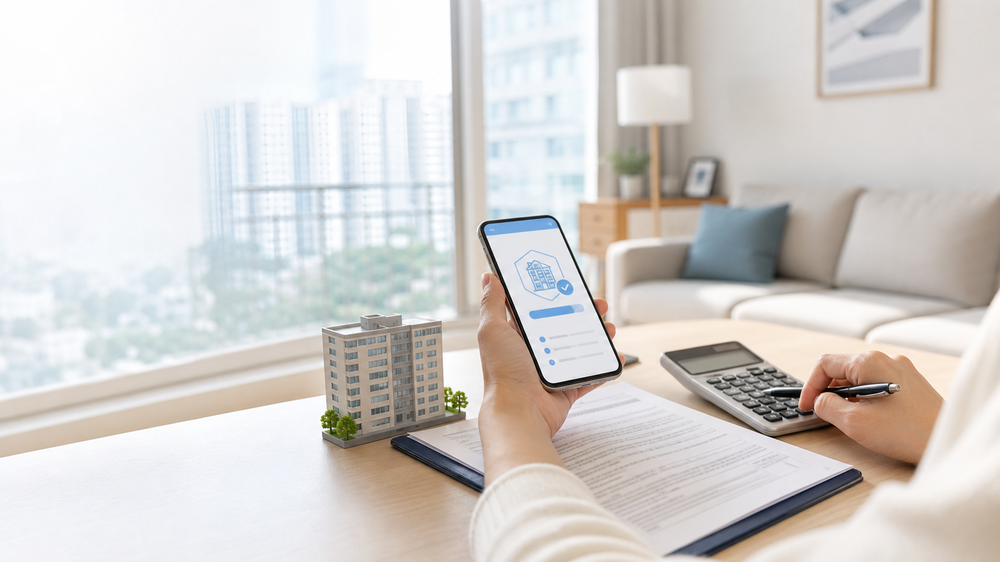

매수인이 대출로 잔금을 치르는 아파트에서 매도인의 압류·가압류·체납이 보이면, 계약을 바로 해제할지보다 **잔금 지급과 말소 서류를 동시에 맞출 수 있는지**부터 판단해야 한다. 등기부에 권리 제한이 없고 말소 확인 절차가 확보된 경우엔 진행할 수 있지만, 매도인이 체납액을 언제 낼지 설명하지 못하거나 말소 자금이 잔금에 의존하면 잔금일 현금을 따로 묶어야 한다. 단순히 “잔금 때 정리한다”는 말만 믿고 전액을 송금하는 경우에는 맞지 않는다.

## 계약 단계별 확인 서류

마이홈포털은 계약 전 등기사항전부증명서로 소유자와 권리관계를 확인하고, 대금 지급 직전 등기부를 다시 발급하라고 안내한다. 잔금과 소유권이전 서류는 원칙적으로 동시이행 관계다. 확인 순서는 아래처럼 잡는다.

| 단계 | 확인할 자료 | 송금 판단 |
|---|---|---|
| 계약 전 | 등기부 갑구·을구, 건축물대장, 매도인 신분 | 압류·가압류·가등기 있으면 특약 전 서명 보류 |
| 계약 후 | 말소 예정 권리, 금융기관 잔고·상환확인서, 체납 정리 계획 | 말소 금액과 담당 기관을 문서로 남김 |
| 잔금 직전 | 당일 등기부, 매도용 인감증명서, 주민등록초본, 등기필증 | 계약 당시보다 권리가 늘면 전액 송금하지 않음 |
| 잔금일 | 말소 접수 또는 말소 확인, 소유권이전 서류, 영수증 | 은행·법무사·매도인 지급 순서를 맞춤 |

국세나 지방세 체납이 의심된다고 해서 매수인이 매도인의 세금을 대신 납부해야 하는 것은 아니다. 다만 체납으로 압류등기가 있으면 권리 이전이 지연될 수 있으므로, 관할 기관의 말소 절차와 필요 금액을 확인해야 한다. 계약서에는 “잔금 지급일 현재 계약일 이후 새로운 권리 제한을 만들지 않으며, 기존 압류·가압류 등은 매도인의 책임으로 말소하고 말소 확인 후 잔금을 지급한다”는 식으로 구체적인 순서를 적는 편이 낫다. 실제 문구는 중개사와 법무사에게 거래 구조에 맞게 검토받아야 한다.

## 잔금 현금은 두 시나리오로 계산한다

가상 사례로 매매가 6억 원, 계약금 6,000만 원, 잔금 5억4,000만 원, 주담대 승인액 3억6,000만 원이라고 하자. 취득세·중개보수·등기비용을 1,600만 원으로 가정하면 정상 잔금일 자기자금은 **1억9,600만 원**이다.

압류 말소에 4,000만 원이 필요하지만 매도인이 잔금에서 정리하는 구조라면, 매수인은 잔금 5억4,000만 원 전액을 매도인 계좌로 보내는 대신 은행·법무사 확인 아래 말소 비용과 매도인 수령액을 분리하는지 확인해야 한다. 대출 실행이 말소 접수 전 불가능하다면 최소 4,000만 원을 대체할 현금이 필요하다. 따라서 계약 판단용 준비액은 정상 시나리오 1억9,600만 원과 지연 시나리오 2억3,600만 원을 따로 적는다. 이는 실제 승인이나 세금 고지액이 아닌 계산 예시다.

## 계약 전 체크리스트

- [ ] 계약 당일과 잔금 직전 등기부를 각각 발급한다.
- [ ] 압류·가압류의 채권자, 금액, 말소 담당자와 일정을 적는다.
- [ ] 잔금 지급 순서와 소유권이전 서류 교부 순서를 특약에 남긴다.
- [ ] 대출은행에 권리 말소 조건과 실행 가능일을 확인한다.
- [ ] 정상 잔금과 말소 지연 시 필요한 대체 현금을 둘 다 계산한다.
- [ ] 취득세는 잔금 후 60일 이내 소유권이전등기 일정과 함께 법무사에게 확인한다.

마이홈포털과 생활법령정보 모두 잔금 직전 권리관계 재확인을 안내한다. 매수인의 핵심 판단은 “체납이 있느냐” 하나가 아니라, **말소가 확인된 뒤에도 대출·취득세·등기 비용을 감당할 현금이 남느냐**다. 확인되지 않은 말소를 전제로 잔금표를 만들지 않는 것이 안전하다.

참고: [마이홈포털 주택 매매 절차](https://www.myhome.go.kr/hws/portal/cont/selectHouseSalesProcedureGuideView.do), [찾기쉬운 생활법령정보-부동산 권리관계 확인](https://www.easylaw.go.kr/CSP/CnpClsMain.laf?ccfNo=3&cciNo=1&cnpClsNo=5&csmSeq=649)
